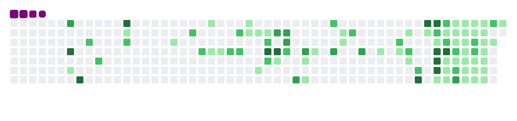
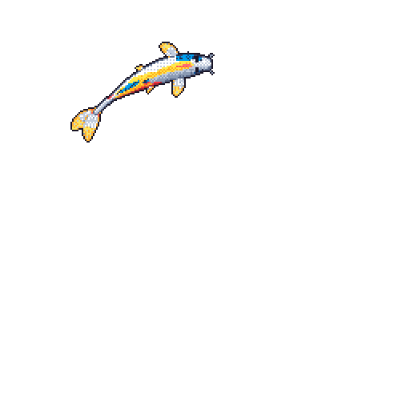

# **_ Hi, you have reached Mahesh's GitHub profile _**
### 🌸 About me ?
My persona falls under INFJ-A, or as per the <a href="https://bigfive-test.com"> Big-5 metrics</a>. Having a discussion about human psychology, count me in. Apart from that, I am also interested in Science, the Universe, and all other super cool stuff, including Aliens 🤫. Just like the rest, I am also a CS engineer. I try to learn new stuff, and on the way, I implement it in my own style. 
- ☮ My side activities: 🎨♟🎧🌐
- 🌱 I’m currently learning the things that I don't know.
- 😄 Pronouns: He would be fine.
- ⚡ Fun fact: The QWERTY keyboard layout was designed to slow you down.

<picture>
  <source media="(prefers-color-scheme: dark)" srcset="Assets/github-contribution-grid-snake-dark.gif">
  <source media="(prefers-color-scheme: light)" srcset="Assets/github-contribution-grid-snake-light.gif">
  
</picture>

### 📫 Wanna reach me
You can ping me at any of the socials that you find at this page. I am not super active, but I will reply when I see it.

<table style="border: none;">
  <tr>
    <!-- Left Column: Vertical Social Links -->
    <td valign="center" align="center" width="80">
       
      
        
      
        
      
        
      
    </td>
    <!-- Right Column: Koi Fish GIF -->
    <td valign="center" align="center" style="border: none;">
      <picture></picture>
    </td>
  </tr>
</table>

### 🔰 While you are still here, have a look at some random quotes
*It changes every day*

<!-- BLOG-POST-LIST:START -->
 1.  "You cannot just work out and then eat poorly and expect to lose weight. It doesn’t work that way."   &emsp;&emsp;&emsp; <i>-by Jennifer Hudson</i> 

 2.  "Somebody should tell us, right at the start of our lives, that we are dying. Then we might live life to the limit, every minute of every day. Do it! I say. Whatever you want to do, do it now!"   &emsp;&emsp;&emsp; <i>-by Michael Landon</i> 

 3.  "Know, first, who you are; and then adorn yourself accordingly."   &emsp;&emsp;&emsp; <i>-by Epictetus</i> 

 4.  "For the sense of smell, almost more than any other, has the power to recall memories and it is a pity that you use it so little."   &emsp;&emsp;&emsp; <i>-by Rachel Carson</i> 
<!-- BLOG-POST-LIST:END -->
Fetched from <a href="http://quotationspage.com"> The Quotations Page</a>.
<!-- The above quotes are fetched from " http://quotationspage.com " and the github action used was gautamkrishnar/blog-post-workflow@master -->
