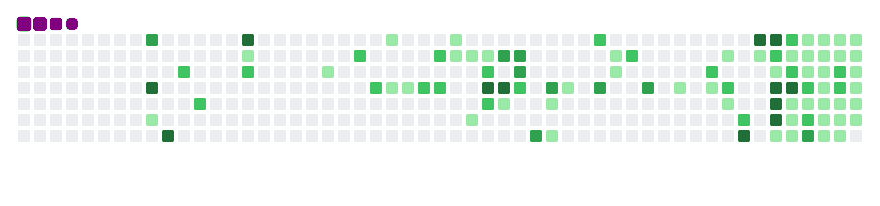

# **_ Hi, you have reached Mahesh's GitHub profile _**
### 🌸 About me ?
My persona falls under INFJ-A, or as per the <a href="https://bigfive-test.com/result/692c68083b5a3f3f12dd9937"> Big-5 metrics</a>. Having a discussion about human psychology, count me in. Apart from that, I am also interested in Science, the Universe, and all other super cool stuff, including Aliens 🤫. Just like the rest, I am also a CS engineer. I try to learn new stuff, and on the way, I implement it in my own style. 
- ☮ My side activities: 🎨♟🎧🌐
- 🌱 I’m currently learning the things that I don't know.
- 😄 Pronouns: He would be fine.
- ⚡ Fun fact: The QWERTY keyboard layout was designed to slow you down.

<picture>
  <source media="(prefers-color-scheme: dark)" srcset="Assets/github-contribution-grid-snake-dark.gif">
  <source media="(prefers-color-scheme: light)" srcset="Assets/github-contribution-grid-snake-light.gif">
  
</picture>

### 📫 Wanna reach me
You can ping me at any of the socials that you find at this page. I am not super active, but I will reply when I see it.

|  |  |  |  |
| :---: | :---: | :---: | :---: |

### 🔰 While you are still here, have a look at some random quotes
*It changes every day*

<!-- BLOG-POST-LIST:START -->
 1.  "I started concentrating so hard on my vision that I lost sight."   &emsp;&emsp;&emsp; <i>-by Robin Green</i> 

 2.  "Though I am grateful for the blessings of wealth, it hasn't changed who I am. My feet are still on the ground. I'm just wearing better shoes."   &emsp;&emsp;&emsp; <i>-by Oprah Winfrey</i> 

 3.  "Nothing in the world can take the place of Persistence.  Talent will not; nothing is more common than unsuccessful men with talent.  Genius will not; unrewarded genius is almost a proverb.  Education will not; the world is full of educated derelicts.  Persistence and determination alone are omnipotent. The slogan 'Press On' has solved and always will solve the problems of the human race."   &emsp;&emsp;&emsp; <i>-by Calvin Coolidge</i> 

 4.  "One of the best rules in conversation is, never to say a thing which any of the company can reasonably wish had been left unsaid."   &emsp;&emsp;&emsp; <i>-by Jonathan Swift</i> 
<!-- BLOG-POST-LIST:END -->
Fetched from <a href="http://www.quotationspage.com/data/mqotd.rss"> The Quotations Page</a>.
<!-- The above quotes are fetched from " http://www.quotationspage.com/data/mqotd.rss " and the github action used was gautamkrishnar/blog-post-workflow@master -->
